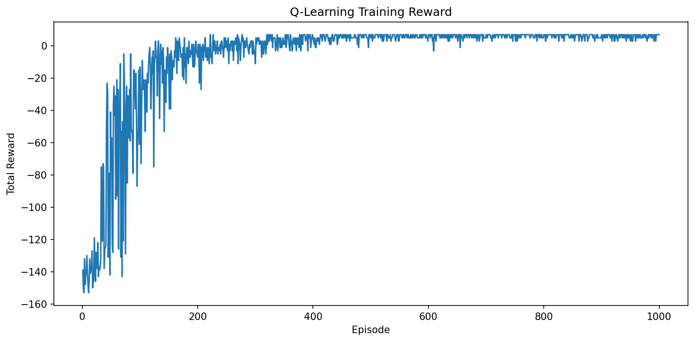
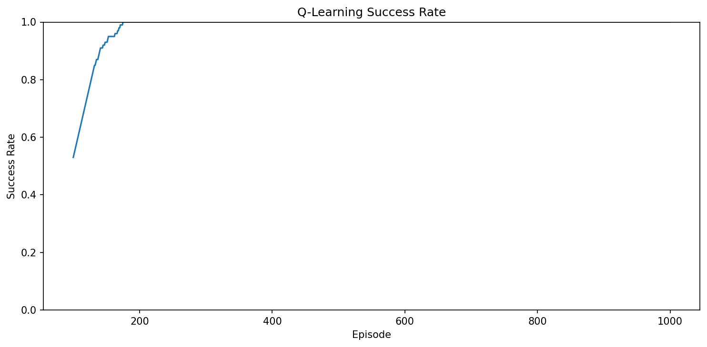
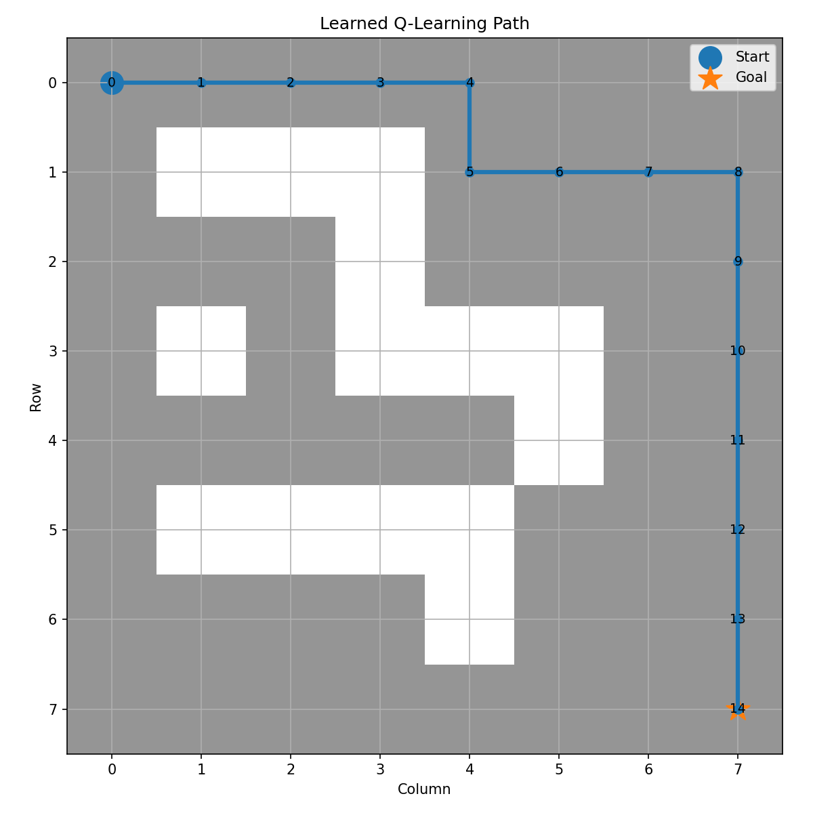
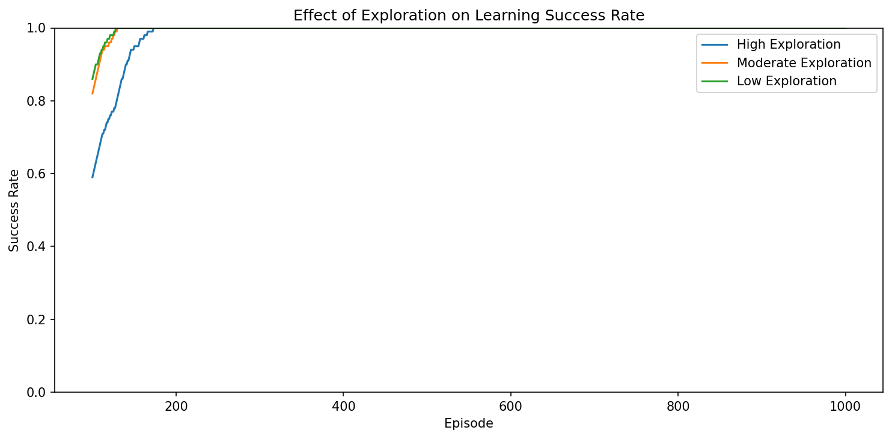
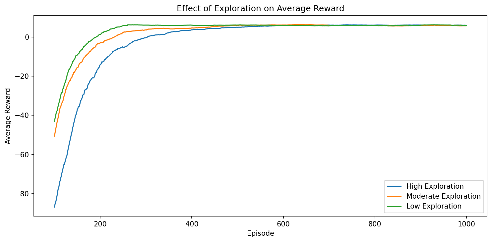
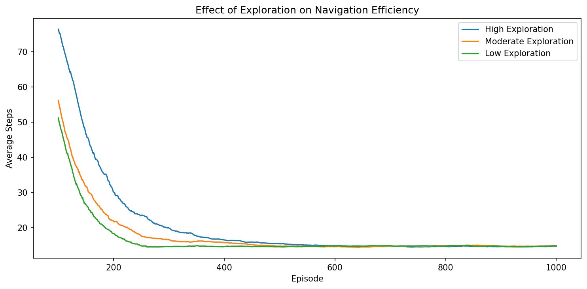

# Learning to Navigate: A Reinforcement Learning Agent in a Grid-World Environment

## 1. Title and short project introduction

This project asks a very basic but important reinforcement-learning question:

> Can an agent learn an effective navigation policy through trial-and-error using rewards?

The setting is a small grid-world game. The agent starts at one location, tries to reach a goal, and learns from the consequences of its actions. It does not receive a map of the correct path. Instead, it has to discover which movements are useful by interacting with the environment and interpreting the reward signal.

What makes this project interesting is the distinction between the game and the learning problem.

- The grid is the experimental environment.
- The actual research question is about learning behavior.
- The agent is not being told how to navigate.
- It is learning from experience.

This is a good project for understanding reinforcement learning because the environment is small enough to see clearly, but rich enough to capture the core ideas of states, actions, rewards, and learning from feedback.

---

## 2. The original idea

The simplest version of the problem is this:

- the agent starts at a starting position
- there is a goal somewhere on the grid
- obstacles block some routes
- the agent can move up, down, left, or right
- the agent is not given the correct path
- it must discover useful behavior through trial and error
- rewards tell it whether a choice was good or bad

This is exactly the kind of task reinforcement learning is designed for.

The agent does not receive a labeled dataset of correct actions. Instead, it learns by experimenting. If it moves in a promising direction, it may receive a better reward. If it bumps into a wall or wanders too long, it gets a worse reward. Over many attempts, the agent begins to associate certain states with particular actions that lead to better outcomes.

The progression is the heart of the project:

- environment → interaction → experience → learning → policy

The environment defines the world.
The agent interacts with it.
Those interactions create experience.
The experience updates the learning system.
The learning system produces a policy, meaning a strategy for choosing actions.

That is the entire story of this project: a small decision problem becomes a reinforcement-learning problem, and the agent learns how to act through repeated interaction.

---

## 3. Visualize the GridWorld

The environment is an 8×8 grid with a fixed obstacle layout. It is defined in `environment/grid_world.py` and rendered by the `GridWorld.render()` method.

The project uses these symbols:

- `A` = the agent
- `G` = the goal
- `#` = obstacle
- `.` = empty space

The actual obstacle layout is fixed in the code:

```text
A . . . . . . .
. # # # . . . .
. . . # . . . .
. # . # # # . .
. . . . . # . .
. # # # # . . .
. . . . # . . .
. . . . . . . G
```

This is the environment the agent learns in. The start is at `(0, 0)`, the goal is at `(7, 7)`, and the obstacles are fixed. That is important because the project is about learning a policy for this particular environment, not about building a universally general navigation system from the start.

The obstacles are not random. They are deliberately placed to create a navigation challenge. The agent must learn to go around them while still reaching the goal efficiently.

---

## 4. Formulating the problem as an MDP

Reinforcement learning problems are often described as Markov decision processes, or MDPs. In plain language, an MDP is a problem where:

- the agent is in some state
- it can choose an action
- the action changes the state
- the environment gives feedback in the form of a reward
- the agent keeps repeating this cycle to improve

For this project, the MDP is built directly from the GridWorld.

### State

The state is the agent's current position: `(row, column)`.

In this environment, the current position is enough information for the agent to decide what to do next. The agent is not tracking a huge world model; it only needs to know where it is on the grid at the current moment because the environment is deterministic and fixed.

This is a crucial simplification. The project is intentionally small, which makes a Q-table feasible and easy to understand.

### Action

At each state, the agent can choose one of four actions:

- Up
- Down
- Left
- Right

The action choices are encoded as constants in `GridWorld`:

- `UP = 0`
- `DOWN = 1`
- `LEFT = 2`
- `RIGHT = 3`

### Transition

A transition is what happens after the agent picks an action.

The code in `environment/grid_world.py` computes a proposed new position and then checks whether the move is valid.

There are several outcomes:

- valid movement into empty space
- moving outside the grid boundary
- stepping onto an obstacle
- reaching the goal

Examples from the actual environment:

- If the agent is at `(2, 2)` and chooses `RIGHT`, it may move to `(2, 3)` if that cell is free.
- If the target cell is outside the 8×8 board, the move is rejected and the agent stays in place.
- If the target cell is an obstacle, the move is rejected and the agent stays in place.
- If the move places the agent on `(7, 7)`, the goal is reached and the episode ends.

These transition rules are what make the environment behave like a real decision process: actions have consequences, and the environment responds to them.

### Reward

The reward function is a critical design choice. The project uses:

- normal movement = `-1`
- obstacle/wall = `-2`
- goal = `+20`

This design is deliberate.

A negative reward for ordinary movement is not meant to punish the agent for moving. It is meant to encourage efficient paths. If every step costs a small penalty, the agent learns that reaching the goal quickly is better than wandering around for a long time.

A larger penalty for hitting a wall or obstacle (`-2`) makes those actions even less attractive than a normal move.

The positive reward for reaching the goal (`+20`) is large enough to outweigh the cost of many steps, but not so large that the agent ignores efficiency. In other words, the reward system encourages the agent to solve the task while avoiding wasted motion.

This is a practical RL lesson: the reward function shapes the behavior. The agent does not understand the goal in a human-like sense. It only learns which actions lead to better cumulative rewards.

### Episode

An episode is one attempt to reach the goal from the start state.

In this project, an episode begins at the start position and ends when the agent:

- reaches the goal, or
- exceeds the step limit of 100 moves

This means the agent may fail by wandering too long or getting stuck in a loop before making progress.

### Discount factor

The project uses a discount factor of `gamma = 0.9` in the Q-learning implementation.

Conceptually, this means the agent does not care only about the immediate reward. It also considers the future consequences of its current action. A good action might not give a large reward immediately, but it may set up a strong path toward the goal later.

The discount factor is one way to tell the agent that future rewards still matter, even if they arrive a few steps later.

---

## 5. How the agent learns

Now we get to the central idea: how does the agent move from random wandering to useful navigation?

At the beginning, the agent does not know which actions are valuable in which states. It is starting from zero knowledge. Every step is a guess. Some guesses happen to be better than others, and those better outcomes become information.

This is exactly where Q-learning enters.

The agent learns a table of values called a Q-table. A Q-table stores a number for each state-action pair. In plain English:

> For this position, how good does it seem to take this action?

The table is shaped like this in the project:

- 64 grid positions
- 4 possible actions
- one learned value for each position-action pair

That produces a table of shape `(64, 4)`, which matches the code in `scripts/q_learning.py`.

A Q-value is not a magic score. It is a learned estimate of how valuable an action is from a given state. If the agent is in a particular grid cell and considers going right, the Q-value tells it how promising that move appears based on its past experience.

A small example helps the intuition:

- from a state near the goal, moving right may have a high value
- from a state near an obstacle, moving down may have a low value
- from a starting region, left may not be useful if it leads into a wall

As the agent tries actions and receives rewards, it updates those numbers. Over time, the table becomes a compact memory of the agent's experience.

This is why the project works well as a teaching example: the Q-table is simple enough to visualize conceptually, but it still captures real learning behavior.

---

## 6. Q-learning implementation

The actual implementation is in `scripts/q_learning.py`.

The class is `QLearningAgent`, and the important pieces are the following.

### Learning rate

The agent uses a learning rate of `0.1`.

This controls how strongly the agent updates its estimates after each experience. A learning rate that is too high can cause unstable learning; a learning rate that is too low can make learning very slow. In this project, the value is small enough to give steady learning without jumping too sharply from one estimate to another.

### Discount factor

The agent uses `discount_factor = 0.9`.

This matches the conceptual explanation above: future rewards are still valuable, but not as valuable as immediate rewards.

### Epsilon

The agent begins with `epsilon = 1.0` and slowly decays to `0.05` during training.

This is the exploration rate. It says: with some probability, choose a random action instead of the one the agent currently believes is best.

### Q-table

The Q-table is initialized as an array of zeros:

```python
self.q_table = np.zeros((64, 4))
```

This means the agent starts without knowing anything useful. It has no reliable preferences yet. Every state-action value begins at zero.

### State-to-index conversion

The agent converts a state like `(row, column)` into a single index for the Q-table:

```python
return row * 8 + col
```

Because the grid is 8×8, there are 64 possible positions. A state is mapped into a unique table row, and the four action values are stored as columns.

### Action selection

The method `choose_action(state)` implements epsilon-greedy behavior.

This means:

- with probability `epsilon`, the agent explores by choosing a random action
- otherwise, it exploits by selecting the action that currently has the highest Q-value in that state

This is the central trade-off in RL: when to try something new versus when to trust previous experience.

### Q-value update

The update rule is the standard Q-learning update:

```python
Q(s, a) = Q(s, a) + alpha * (target - Q(s, a))
```

In the project, this is implemented in `update()`.

The idea is simple:

- the current Q-value is adjusted toward a target estimate
- the target includes the immediate reward and the discounted best future value
- the update is only a partial correction, not a full replacement

This means learning is gradual. The agent gets better over time instead of instantly knowing the answer.

The implementation is intentionally simple and transparent, which is exactly what makes it a useful learning project.

---

## 7. Exploration vs exploitation

One of the most important RL ideas is the exploration-exploitation trade-off.

If the agent always follows the action it currently thinks is best, it may never discover a better route that it has not yet tested. That is the problem of exploitation.

But if the agent explores too much, it keeps taking random actions and may fail to use the knowledge it already has. That is the problem of over-exploration.

The project manages this with epsilon-greedy learning.

- exploration means trying an action that is not currently estimated to be best
- exploitation means preferring the action that currently has the highest value
- epsilon controls how often exploration happens

At the start of training, the agent explores heavily because it knows almost nothing. The raw notes and training output show that the initial epsilon is 1.0. This means early episodes are dominated by random behavior.

As training continues, the project gradually reduces epsilon:

```python
agent.epsilon = max(0.05, agent.epsilon * 0.995)
```

This means the agent becomes less random and more confident as it accumulates experience.

This is a good example of how RL balances two competing needs:

- discover useful actions
- then rely on them effectively

The project does not treat this as a theoretical abstraction. It is built directly into the learning loop and the training process.

---

## 8. Training the agent

The actual training loop is in `scripts/train_agent.py`.

The training story is straightforward:

1. reset the environment
2. observe the current state
3. choose an action
4. take the action
5. receive the reward and next state
6. update the Q-table
7. repeat until the episode ends
8. start a new episode

The script trains for `NUM_EPISODES = 1000` and uses `MAX_STEPS = 100` per episode.

This matters because:

- 1000 episodes gives the agent enough repeated experience to learn meaningful patterns
- the 100-step limit prevents episodes from running forever
- the environment is small, so long episodes are not needed to keep the problem interesting

The training loop also tracks:

- total reward per episode
- steps per episode
- whether the episode ended successfully

These values are summarized in the printed training output and plotted into saved visualizations.

The notes recorded during the run show the following progression:

- Episode 100/1000: Reward = -13.0, Steps = 29, Success rate = 53.00%, Epsilon = 0.606
- Episode 200/1000: Reward = -7.0, Steps = 24, Success rate = 100.00%, Epsilon = 0.367
- Episode 300/1000: Reward = -11.0, Steps = 29, Success rate = 100.00%, Epsilon = 0.222
- Episode 400/1000: Reward = 5.0, Steps = 16, Success rate = 100.00%, Epsilon = 0.135
- Episode 500/1000: Reward = 7.0, Steps = 14, Success rate = 100.00%, Epsilon = 0.082
- Episode 1000/1000: Reward = 7.0, Steps = 14, Success rate = 100.00%, Epsilon = 0.050

This is a clear learning curve: the agent starts with uncertain behavior, then moves into consistent goal-reaching behavior. By around episode 200, the success rate is already 100% in the recorded run.

The script saves the learned Q-table:

```text
experiments/q_table.npy
```

and saves training plots:

- `plots/q_learning_rewards.png`
- `plots/q_learning_success_rate.png`

---

## 9. Training results

The saved training plots are the clearest way to understand whether learning happened.

### Reward plot



This plot answers the question: Did the agent get better over time?

The project notes describe it as measuring how good each episode was. The value is not just whether the goal was reached; it also reflects efficiency and the consequences of movement. Because each step has a cost of `-1` and obstacles cost `-2`, the reward curve reflects both whether the agent solved the task and how efficiently it did it.

What to look for:

- very early episodes show noisy and often poor rewards
- later episodes stabilize into consistently better totals
- a consistent high reward indicates the agent is learning to reach the goal efficiently

### Success-rate plot



This plot answers the question: How often is the agent actually reaching the goal?

The raw training output shows that success becomes reliable around the 200-episode range, with the success-rate plot reaching 100% under the recorded training run. The project notes describe this as evidence that the agent gained a reliable policy for this fixed environment.

What to look for:

- the success rate starts lower and becomes more reliable over time
- the curve approaches 1.0 as the agent learns to navigate consistently
- a high success rate is different from a high reward alone: the agent may reach the goal but still do it inefficiently

### Why these plots matter

These two views complement each other:

- the reward plot captures performance quality
- the success-rate plot captures reliability

Together they show that the agent is not merely acting randomly. It is learning a policy that repeatedly gets the agent to the goal in this environment.

---

## 10. Random-agent baseline

Before the Q-learning agent learned anything, the project created a random baseline in `scripts/random_agent.py`.

The reason for the baseline is simple and important:

> What happens if the agent does not learn at all?

The script runs 1000 episodes with completely random actions. It does not update a Q-table. It simply takes random moves until the episode ends or the step limit is reached.

The observed result from the project output is:

- Episodes: 1000
- Success rate: 10.00%
- Average reward: -134.24
- Average steps: 97.27

This is very different from the trained Q-learning agent.

The baseline shows the project is not just observing behavior in a simple environment; it is measuring the difference between random movement and learned navigation. Without learning, the agent rarely reaches the goal and accumulates a negative average reward because it keeps moving around the grid and hitting penalties.

This makes the learning result more meaningful. The improvement is not being assumed; it is being compared against a non-learning baseline.

---

## 11. The learned policy

Once the Q-table was trained, the project evaluated the learned policy without exploration.

This is done in `scripts/run_agent.py` and `scripts/visualize_path.py`.

The key idea is that the agent should no longer be exploring randomly. It should use what it has learned. That is why the scripts set:

```python
agent.epsilon = 0.0
```

The agent is now behaving greedily according to the learned Q-values, not sampling random actions.

The saved visualization from `plots/learned_path.png` shows the path selected by the learned policy.



This is an important visual because it shows the end result of learning.

What the path represents:

- each step is a move selected by the agent from its learned Q-values
- the path shows how the policy behaves when it is no longer exploring
- it makes the learned strategy visible in a way that raw Q-values do not

Why this matters:

- the path was not hard-coded into the environment
- the agent did not receive an explicit route
- the behavior came from repeated learning from rewards and transitions

This path is the practical expression of the Q-table. The agent is following the action that, in its learned experience, appears to be the best available choice from each state.

The project notes emphasize that this is not a human-like understanding of the environment. It is simply a learned decision strategy.

---

## 12. Exploration experiment

Once the baseline version worked, the project asked a second research question:

> How does the amount of initial exploration affect learning?

This experiment is implemented in `scripts/exploration_experiment.py` and summarized by `scripts/analyze_exploration.py`.

The project keeps the environment, rewards, learning algorithm, and training length fixed while changing only the initial epsilon value.

The experiment compares three strategies:

- High Exploration: initial epsilon = 1.0
- Moderate Exploration: initial epsilon = 0.5
- Low Exploration: initial epsilon = 0.1

This is important because the experiment is trying to isolate the effect of exploration. If several things changed at once, it would be impossible to know what caused the different outcomes.

The final experiment results from the project are the ones that matter for the write-up:

- High exploration: final success rate 100%, average reward 6.02, average steps 14.77
- Moderate exploration: final success rate 100%, average reward 5.82, average steps 14.87
- Low exploration: final success rate 100%, average reward 5.92, average steps 14.93

The convergence analysis defines convergence as reaching at least 90% success over a rolling 100-episode window.

The actual convergence results are:

- High exploration: episode 140
- Moderate exploration: episode 108
- Low exploration: episode 104

This means that, in this specific GridWorld and setup, the low-exploration agent reached the chosen success threshold the earliest. The moderate and high-exploration agents took longer to reach the same threshold.

But the final averages tell a different story:

- low exploration reached the threshold sooner
- high exploration produced slightly better final average efficiency in terms of steps

This is exactly why the project notes stress a careful interpretation. The conclusion is not that low exploration is always better or that high exploration is always better. The result is specific to this environment and this setup.

The proper conclusion is:

> In this particular GridWorld and experimental setup, lower initial exploration reached the chosen success threshold sooner, while higher exploration produced slightly better final average efficiency.

That is a measured, environment-specific statement, and it is the correct one for this project.

---

## 13. Experimental visualizations

The project includes several saved plots that answer specific questions about learning and exploration.

### Exploration success-rate plot



This plot asks:

> How quickly do different exploration levels lead to reliable success?

What to look for:

- the success-rate curves for all three strategies eventually reach 1.0
- the timing of the rise differs across strategies
- lower initial exploration reaches the chosen threshold earlier in this setup

### Exploration reward plot



This plot asks:

> How does exploration affect the quality of rewards during learning?

The project notes emphasize that average reward and average steps are not the same as success rate. A strategy may succeed reliably while still being slightly less efficient in terms of reward or path length.

### Exploration steps plot



This plot asks:

> How efficiently does each strategy solve the task as training progresses?

It is especially useful for understanding the final efficiency comparison:

- high exploration ends with slightly fewer average steps in the final window
- moderate and low exploration become competitive but are not identical

### Training visualizations

The project also includes the main training plots:

- `plots/q_learning_rewards.png`
- `plots/q_learning_success_rate.png`

These visualize the learning process directly and are the clearest demonstration that the agent improves over time.

### Learned path

The path visualization in `plots/learned_path.png` is the most intuitive “final answer” plot in the project. It shows the route selected by the fully trained policy without exploration.

Together, the plots tell a coherent story:

- random behavior is poor
- learning improves reward and reliability
- exploration affects convergence speed and final efficiency
- a trained policy produces a distinct navigation path

---

## 14. Full RL learning loop diagram

The raw project notes describe the RL loop as a cycle of observation, action, reward, and update. The project does not include a separate saved diagram file, but the structure is clear enough to represent directly:

```text
State
  ↓
Action
  ↓
Environment
  ↓
Reward + Next State
  ↓
Learning Update
  ↓
Next Action
  ↑
────────────
```

In the project, that loop is implemented as follows:

- the state is the current `(row, column)` position
- the action is one of up/down/left/right
- the environment applies the move and returns the next state
- the reward tells the agent whether that choice was good or bad
- the Q-learning update adjusts the Q-value for that state-action pair
- the next action is then selected using the updated knowledge

This is the central mechanism behind the project: the agent learns by repeatedly running this loop.

---

## 15. Limitations

It is important to be honest about what the project demonstrates and what it does not.

### Fixed environment

The agent learns this particular obstacle layout.

The environment is fixed in `GridWorld.__init__`: the start, goal, and obstacle layout never change during training. The agent becomes familiar with one specific problem instance. That is a strength for teaching, but it also means the project does not prove that the learned policy works on new obstacle layouts or different maps.

### Small state space

The Q-table approach works because the environment is tiny.

There are only 64 positions, so storing a number for each state-action pair is manageable. For a much larger grid, a more complex map, or a state representation that includes more variables, a tabular Q-table would become impractical very quickly.

This is one of the reasons advanced reinforcement learning often uses function approximation, such as neural networks, instead of a simple table.

### Generalization

The project does not claim that the agent generalizes automatically to a new grid layout.

A future research experiment could change the obstacle configuration and check whether the learned policy still performs well. That would be a generalization experiment. It was not performed here, so it should not be described as a result of the project.

### Experimental scope

The exploration experiment only tells us what happened under this environment and under this specific set of training conditions.

It does not support a universal rule such as:

- low exploration is always best
- high exploration is always best

It only tells us what happened in this project.

---

## 16. What I learned

This project taught the core ideas of reinforcement learning in a very concrete way.

It made the abstract concepts more tangible:

- a state is a position in the grid
- an action is a move up/down/left/right
- a reward is the numerical feedback that tells the agent what happened
- a policy is the strategy the agent uses to choose actions
- a Q-value is an estimate of how good an action appears to be from a specific state
- a Q-table is the memory of those estimates across the whole environment

The project also made the training process concrete. The agent does not start knowing the answer. It starts by exploring and receiving feedback. Through many episodes, it updates its internal estimates and gradually shifts from random movement toward a more deliberate policy.

The exploration-vs-exploitation trade-off was central. The agent had to decide whether to try something new or trust what it had already learned. That tension is one of the defining ideas in reinforcement learning.

Finally, the project reinforced a research habit that is especially important in ML: compare against a baseline and keep the experiment controlled. The random agent showed what happens without learning, and the Q-learning agent showed what happened with learning. The exploration experiment then showed that changing the initial exploration level changes the learning dynamics in a specific and measurable way.

---

## 17. Conclusion

The original research question was:

> Can an agent learn an effective navigation policy through trial-and-error using rewards?

In this project, the evidence suggests that yes, it can, at least in the fixed GridWorld environment used here.

The trained Q-learning agent learned a reliable policy, reached the goal consistently, and improved compared with a random baseline. The reward and success-rate plots show the learning progression, while the learned-path visualization makes the eventual policy visible.

The exploration experiment added an important nuance. In this specific environment, lower initial exploration reached the chosen success threshold sooner, while higher exploration led to slightly better final average efficiency. That result is meaningful for this project, but it should not be generalized beyond the setup that was actually tested.

The project is therefore a good example of both the promise and the limits of reinforcement learning in a small, controlled setting. It shows that an agent can learn useful behavior from rewards, but it also reminds us that the result depends on the environment, the reward design, and the training setup.

---

## 18. Project structure

This is the actual project structure in the repository:

```text
project-4-reinforcement-learning/
├── environment/
│   ├── __init__.py
│   └── grid_world.py
├── experiments/
│   ├── exploration_results.pkl
│   └── q_table.npy
├── plots/
│   ├── exploration_reward.png
│   ├── exploration_steps.png
│   ├── exploration_success_rate.png
│   ├── learned_path.png
│   ├── q_learning_rewards.png
│   └── q_learning_success_rate.png
├── raw-project-notes.md
├── README.md
├── requirements.txt
└── scripts/
    ├── analyze_exploration.py
    ├── exploration_experiment.py
    ├── q_learning.py
    ├── random_agent.py
    ├── run_agent.py
    ├── test_environment.py
    ├── train_agent.py
    └── visualize_path.py
```

The repository currently includes an empty `requirements.txt`. The scripts import `numpy` and `matplotlib`, and the project is written as Python modules rather than notebooks.

---

## 19. Running the project

These are the project commands that match the repository's actual structure and import style.

### Test the environment

```bash
python -m scripts.test_environment
```

This checks that the environment is initialized correctly and that a move updates the state and reward as expected.

### Run the random baseline

```bash
python -m scripts.random_agent
```

This produces the baseline performance numbers without any learning.

### Train the Q-learning agent

```bash
python -m scripts.train_agent
```

This trains the agent over 1000 episodes, updates the Q-table, and saves the learned values and training plots.

### Evaluate the trained policy

```bash
python -m scripts.run_agent
```

This loads the saved Q-table and runs the policy without exploration.

### Plot the learned path

```bash
python -m scripts.visualize_path
```

This renders the learned route into `plots/learned_path.png`.

### Run the exploration experiment

```bash
python -m scripts.exploration_experiment
```

This evaluates different initial exploration settings and saves the raw experiment results plus the exploration plots.

### Analyze convergence

```bash
python -m scripts.analyze_exploration
```

This reports when each exploration strategy first reaches the 90% success threshold within a rolling 100-episode window.

If you want to install the dependencies used by the scripts, the repository currently has an empty `requirements.txt`, so the usual direct install would be:

```bash
python -m pip install numpy matplotlib
```

This is consistent with the imports used in the project code.

---

## Final reflection

This project is a good introduction to reinforcement learning because it makes the logic visible. The agent is not hidden behind a large library. It is a simple learner in a simple environment, but it still captures the essential idea: learning through interaction, rewards, and repeated trial and error.

The state is a position. The action is a move. The reward is the signal. The Q-table is the memory. The policy is the final behavior. The plots show the learning process. The experiments show how the design decisions affect learning.

And that is exactly why this project is a useful teaching tool: it turns the abstract ideas of reinforcement learning into a concrete, visual, and measurable system.
